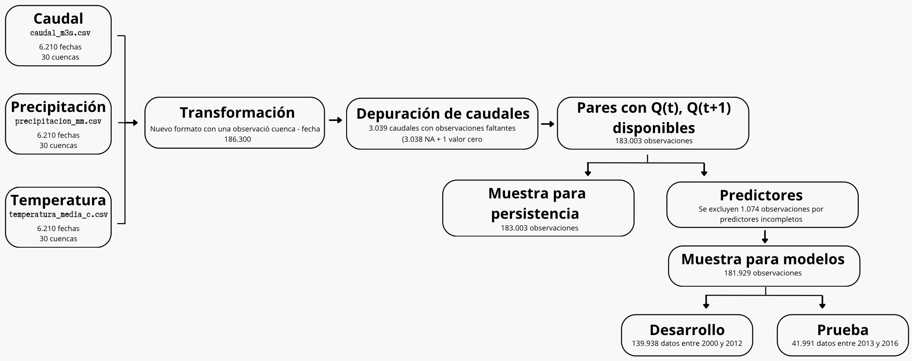

```{=latex}
\thispagestyle{empty}
\noindent
\begin{minipage}[c]{0.17\textwidth}
  \includegraphics[width=\linewidth]{logouc.png}
\end{minipage}%
\hspace{0.6cm}%
\begin{minipage}[c]{0.7\textwidth}
  \raggedright
  \fontsize{11}{15}\selectfont
  \textsc{Pontificia Universidad Católica de Chile}\\
  \textsc{Facultad de Matemáticas}\\
  \textsc{EYP3407 -- Tópicos Aplicados en Estadística}\\
  \textsc{Profesor: Eloy Alvarado Narváez}\\
  \textsc{Ayudante: Andrés Díaz}
\end{minipage}

\begin{center}
  {\Large\bfseries Informe final\par}
  \vspace{0.1cm}
  {\large 12 de noviembre de 2026\par}
  {\normalsize Javier Encina -- Camila Moreno -- Romina Navarro -- Javiera Sotolincoñir\par}
  {\normalsize\bfseries ¿Cuánto mejora un modelo estadístico la predicción del caudal del día siguiente frente a mantener el caudal observado hoy?\par}
\end{center}
```

## Resumen ejecutivo

Escribe aquí el resumen ejecutivo del informe (máximo 250 palabras).

## Problema y datos
\textcolor{blue}{¿Qué es una cuenca? - Listo}

Una cuenca corresponde a una zona donde el agua proveniente de lluvias, deshielos o manantiales desemboca en un cuerpo de agua común como un río, lago u océano. Las cuencas desempeñan un papel crucial pues determinan tanto cantidad como disponibilidad del agua, además de ser fundamentales para la agricultura (Washington State Department of Ecology, s. f.).

\textcolor{blue}{Por qué es importante predecir cuencas y cual es la dificultad - Listo}

En ese contexto, la predicción del caudal del día siguiente constituye una herramienta potencialmente útil para la gestión y planificación de los recursos hídricos. Sin embargo, esta tarea presenta dificultades debido a la variabilidad de las condiciones meteorológicas y a las diferencias físicas entre cuencas, que pueden provocar comportamientos hidrológicos distintos.

\textcolor{blue}{Cómo lo haremos - Listo}

Para responder la pregunta de investigación se comparan distintos procedimientos estadísticos en base a registros históricos y características del caudal, además de antecenetes de precipitación y temperatura.

\textcolor{blue}{Origen de los datos - Listo}

Los datos provienen de CAMELS-CL (Catchment Attributes and Meteorology for Large Sample Studies, Chile), la primera base de datos hidrometeorológica y de atributos a gran escala desarrollada para Chile. Esta reúne información de 516 cuencas chilenas y fue presentada por Alvarez-Garreton et al. (2018).

En particular, los datos del informe corresponden a un subconjunto de datos de CAMELS-CL proporcionado para el **Caso 01 del curso EYP3407**, cuya copia de datos fue preparada el 12 de octubre 2026. Dicho subconjunto comprende 30 cuencas ubicadas entre los 33° y 40° de latitud sur, seleccionadas según la mayor cantidad de días con caudal observado entre 2000 y 2012, utilizando el identificador de cuenca como criterio de desempate. Se dispone de cuatro archivos originales con la información de los caudales $Q$, la precipitación y temperatura registrada, además de un diccionario con atributos adicionales. Todos los datos registrados corresponden a la ventana de tiempo generada entre 01/01/2000 y 31/12/2016 (Tabla \ref{tab:archivos}).

```{r}
#| echo: false
#| results: asis
#| warning: false

# Cargar archivos
caudal <- read.csv("datos/caudal_m3s.csv", check.names = FALSE)
precipitacion <- read.csv("datos/precipitacion_mm.csv", check.names = FALSE)
temperatura <- read.csv("datos/temperatura_media_c.csv", check.names = FALSE)
atributos <- read.csv("datos/atributos.csv", check.names = FALSE)

# TABLA DE ARCHIVOS ORIGINALES
tabla_archivos <- data.frame(
  Archivo = c(
    "\\texttt{caudal\\_m3s.csv}",
    "\\texttt{precipitacion\\_mm.csv}",
    "\\texttt{temperatura\\_media\\_c.csv}",
    "\\texttt{atributos.csv}"
  ),
  Descripcion = c(
    "Caudal diario de las 30 cuencas, expresado en m³/s.",
    "Precipitación diaria CR2MET, expresada en mm/día.",
    "Temperatura media diaria CR2MET, expresada en °C.",
    "Atributos físicos, climáticos e hidrológicos de las cuencas."
  ),
  Observaciones = c(
    nrow(caudal),
    nrow(precipitacion),
    nrow(temperatura),
    nrow(atributos)
  )
)

tabla_archivos$Observaciones <- format(
  tabla_archivos$Observaciones,
  big.mark = ".",
  scientific = FALSE,
  trim = TRUE
)

# Generar tabla en LaTeX
latex_archivos <- knitr::kable(
  tabla_archivos,
  format = "latex",
  booktabs = FALSE,
  align = c("l", "l", "r"),
  escape = FALSE,
  linesep = ""
)

# Agregar líneas verticales en TODOS los bordes
latex_archivos <- as.character(latex_archivos)

latex_archivos <- sub(
  "\\\\begin\\{tabular\\}\\{[^}]+\\}",
  "\\\\begin{tabular}{|l|l|r|}",
  latex_archivos
)

cat(paste0(
  "\\begin{table}[H]\n",
  "\\centering\n",
  "\\small\n",
  latex_archivos,
  "\n\\caption{Archivos originales utilizados en el análisis}\n",
  "\\label{tab:archivos}\n",
  "\\end{table}\n"
))
```

\textcolor{blue}{Definir población, unidad, respuesta - Listo}

La **población de estudio** corresponde a las observaciones diarias de las 30 cuencas chilenas incluídas en el subconjunto de datos entregado en la respectiva ventana de tiempo.

La **unidad de observación** se define como un par entre la cuenca y la fecha, de manera que ambas variables en conjunto identifican cada registro. Se define $Q_t$ como el caudal observado en una cuenca durante el día de origen $t$, con $t \in \{1, 2, \cdots, 6.210\}$ correspondiente a las fechas disponibles.

La **variable respuesta** corresponde al caudal del día siguiente definido como $Q_{t+1}$.

\textcolor{blue}{Construcción de la muestra estadística}

Para construir la muestra analítica se re-estructuró inicialmente $\texttt{caudal\_m3s.csv}$ que contiene 6.210 filas y 30 columnas correspondientes a las fechas e identificadores de las cuencas (respectivamente), de tal manera que en el resultado, cada fila contenga el par (ID cuenca - fecha $t$), generando un total de 186.300 observaciones (@fig-muestra).

Posteriormente, las tres series se integraron mediante el identificador de cuenca y la fecha, estableciendo relaciones uno a uno entre registros. Se verificó la unicidad de las claves y la conservación de las 186.300 observaciones después de cada unión, manteniendo las 30 cuencas originales, sin duplicados.


\textcolor{blue}{De aquí para abajno no cuenta}

Por su parte, el archivo `atributos.csv` contiene una fila por cuenca, por lo que su eventual integración a la base diaria correspondería a una relación muchos a uno. Las variables de caudal, precipitación y temperatura media se encuentran expresadas en m³/s, mm/día y °C, respectivamente (Tabla \ref{tab:muestra}).

Durante la revisión de los datos se identificaron 3.038 registros de caudal faltantes y una única observación con caudal igual a cero ($Q=0$), correspondiente a la estación del río Toltén, en la Región de La Araucanía, el 1 de enero de 2003. La cuenca del río Toltén presenta un clima templado cálido lluvioso con influencia mediterránea en sus sectores medio y bajo, y un clima templado frío lluvioso con influencia mediterránea en su sector precordillerano (Dirección General de Aguas [DGA], 2004, p. 5). Considerando estas características, el registro de caudal cero fue identificado como potencialmente anómalo. Dado que el análisis contempla transformaciones logarítmicas, se decidió tratar dicho registro como un valor faltante, sin asumir que se haya confirmado un error de medición. Con ello, se obtuvo un total de 3.039 registros de caudal faltantes.

La variable respuesta se definió como el caudal observado al día siguiente, $Q_{t+1}$, expresado en m³/s, estableciendo un horizonte de predicción de un día. Para construirla, los registros de caudal se desplazaron una fecha hacia adelante dentro de cada cuenca, evitando asociar observaciones pertenecientes a cuencas distintas. Posteriormente, se conservaron únicamente los pares cuenca–fecha con $Q_t$ y $Q_{t+1}$ disponibles, obteniendo una muestra de 183.003 observaciones. No se imputaron los caudales faltantes utilizados como respuestas, con el propósito de evaluar los modelos únicamente sobre valores efectivamente observados.

{#fig-muestra width=40% fig-align="center"}

```{r}
#| echo: false
#| output: false

# Para caudal:
dim(caudal)               # 6210 filas (días) y 31 columnas (fecha + 30 ríos)
sum(is.na(caudal))        # 3038 NA´s: en el archivo vienen como un espacio " ", los lee bien
caudal$fecha <- as.Date(caudal$fecha)
range(caudal$fecha)       # 2000-01-01 a 2016-12-31
table(diff(caudal$fecha)) # los 6209 saltos entre filas son de 1 día
faltantes <- colSums(is.na(caudal[, -1]))
sort(faltantes, decreasing = TRUE) # faltantes por río, de mayor a menor
anio <- format(caudal$fecha, "%Y")
tapply(is.na(caudal[["10102001"]]), anio, sum) #se concentra mayormente en 2016
tapply(is.na(caudal[["7116001"]]), anio, sum) #se concentra mayormente en 2014

# Aquí no podemos simplemente imputar: si rellenaramos datos, por ejemplo con
# una línea recta entre el día anterior y el siguiente, después nuestro
# modelo sería optimista, y el resultado se vería mejor de lo q es.

# un segundo detalle, es que los datos faltante de Liquiñe (10102001), son del 2016
# que sería dentro de la prueba final, por lo que este río tendrá menos días
#para evaluarse y el resultado será más incierto x lo tanto hay que reportar junto
# al error de cada río, cuántos días se evaluaron.

# finalmente, los días sin caudal no se rellenan, solo no entrarán en la evaluación
# ni para el modelo ni para persistencia y luego en el informe tendremos que
# reportar cuántos días se evaluaron por río.

sum(is.na(precipitacion))   # 0: la lluvia está completa
sum(is.na(temperatura))     # 0: la temperatura está completa

# Construcción de la muestra: una fila por caudal y día
cuencas <- names(caudal)[-1] # Los 30 códigos de las cuencas
caudal_largo <- data.frame(
  cuenca = rep(cuencas, each = nrow(caudal)),
  fecha  = rep(caudal$fecha, times = length(cuencas)),
  Q      = unlist(caudal[, -1], use.names = FALSE)
)

dim(caudal_largo) #186300 filas: combinaciones de rio y día (30x6210)

# Comprobación a mano: los dos valores deben coincidir (4.14)
caudal[1, "9127001"]
subset(caudal_largo, cuenca == "9127001" & fecha == as.Date("2000-01-01")) # Bien!

# Hacemos lo mismo para las precipitaciones
precipitacion$fecha <- as.Date(precipitacion$fecha)
cuencas_p <- names(precipitacion)[-1]
precipitacion_largo <- data.frame(
  cuenca = rep(cuencas_p, each = nrow(precipitacion)),
  fecha  = rep(precipitacion$fecha, times = length(cuencas_p)),
  P      = unlist(precipitacion[, -1], use.names = FALSE)
)

# Y para la temperatura:
temperatura$fecha <- as.Date(temperatura$fecha)
cuencas_t <- names(temperatura)[-1]
temperatura_largo <- data.frame(
  cuenca = rep(cuencas_t, each = nrow(temperatura)),
  fecha  = rep(temperatura$fecha, times = length(cuencas_t)),
  Temp   = unlist(temperatura[, -1], use.names = FALSE)
)

# ==========================================
# AUDITORÍA DE CLAVES Y UNIONES
# ==========================================

# Función para revisar cada base
auditar_base <- function(base, nombre) {
  data.frame(
    Base = nombre,
    Filas = nrow(base),
    Cuencas = length(unique(base$cuenca)),
    Claves_unicas = nrow(unique(base[c("cuenca", "fecha")])),
    Duplicados = sum(duplicated(base[c("cuenca", "fecha")]))
  )
}

# Auditar las tres bases originales en formato largo
auditoria <- rbind(
  auditar_base(caudal_largo, "Caudal"),
  auditar_base(precipitacion_largo, "Precipitación"),
  auditar_base(temperatura_largo, "Temperatura")
)

# Primera unión
datos_cp <- merge(
  caudal_largo,
  precipitacion_largo,
  by = c("cuenca", "fecha")
)

# Segunda unión
datos_cpt <- merge(
  datos_cp,
  temperatura_largo,
  by = c("cuenca", "fecha")
)

# Auditar resultados de ambas uniones
auditoria <- rbind(
  auditoria,
  auditar_base(datos_cp, "Caudal + precipitación"),
  auditar_base(datos_cpt, "Caudal + precipitación + temperatura")
)

print(auditoria, row.names = FALSE)

datos <- datos_cpt

# Comprobación
dim(datos)   # 186300 filas, bien!
subset(datos, cuenca == "8130002" & fecha == as.Date("2000-01-02"))
precipitacion[2, "8130002"]

# Hay un caudal igual a cero:
subset(datos, Q == 0)
# Vemos que es un único caso donde Q==0: Toltén (9437002) el 2003-01-01, un caudal
# que lleva cientos de m3/s, así que es casi seguro un error de registro.
# Tenemos 2 opciones: marcarlo como NA, o usar log(Q+epsilon), porque más abajo se aplica log().
# Lo marcamos como NA (dato faltante), coherente con no inventar caudales.
# Se corrige aquí, ANTES de crear Q_manana y Q_ayer, para que el 0 no se copie
# a esas columnas.
# Qudan 3039 caudales faltantes: los 3038 que ya teníamos más este
datos$Q[which(datos$Q == 0)] <- NA

# Ahora, a cada fila le agregamos el caudal del día siguiente del mismo
# río. Primero ordenamos por río, y dentro de cada río por fecha. Así,
# cada fila tendrá abajo el "mañana" (funciona porque el calendario está
# completo)
datos <- datos[order(datos$cuenca, datos$fecha), ]
rownames(datos) <- NULL
datos$Q_manana <- c(datos$Q[-1], NA) # Todo corrido una posición hacia arriba
                                     # con un NA final para que tenga el mismo largo

# Hay un problema: "mañana" solo vale si la
# fila siguiente es del mismo caudal. Si el caudal cambia se pone NA
datos[6209:6212, c("cuenca", "fecha", "Q", "Q_manana")]
datos[12419:12422, c("cuenca", "fecha", "Q", "Q_manana")]

# Comparamos la cuenca de cada fila con la de la fila
# siguiente; si son distintas, es el último día de una cuenca y no tiene "mañana"
ultimo_dia <- c(datos$cuenca[-1] != datos$cuenca[-nrow(datos)], TRUE)
datos$Q_manana[ultimo_dia] <- NA

datos[6209:6212, c("cuenca", "fecha", "Q", "Q_manana")]
datos[12419:12422, c("cuenca", "fecha", "Q", "Q_manana")]
sum(ultimo_dia) # Debería dar 30: bien!

# Crear el "Caudal de ayer"
# 1. El caudal de ayer: con el de hoy, indica si el río viene subiendo o bajando.
# Para "mañana" corrimos la columna hacia arriba y el problema estaba en el último día de cada río.
# Para "ayer" hay que correrla hacia abajo, y el problema estará en el primer día de cada río,
# el 2000-01-01, que no tiene ayer. (El TRUE va al principio en vez de al final.)
datos$Q_ayer <- c(NA, datos$Q[-nrow(datos)])
primer_dia <- c(TRUE, datos$cuenca[-1] != datos$cuenca[-nrow(datos)])
datos$Q_ayer[primer_dia] <- NA

# Crear variables de "Lluvia_acumulada"
# 2. La lluvia acumulada: la lluvia de un solo día no basta para entender un río.
# las ventanas de varios días miden cosas distintas.
# Lluvia de hoy y de ayer: la respuesta rápida, porque un río chico sube el mismo día.
# Últimos 3 o 7 días: el temporal completo.
# Últimos 30 días: qué tan mojado está el suelo. La misma lluvia produce más caudal
# si el suelo ya está saturado.

# No usamos la lluvia de mañana ;) pq sería info futura.
# suma_ultimos(x, n) suma los últimos n días INCLUYENDO hoy. Supuesto que se
# declara en el informe: la lluvia de hoy está disponible al cierre del día.
suma_ultimos <- function(x, n) {
  resultado <- rep(NA, length(x))
  for (i in n:length(x)) {
    resultado[i] <- sum(x[(i - n + 1):i])
  }
  resultado
}

# Creamos lluvia a los 7 días
datos$lluvia_7d <- suma_ultimos(datos$P, 7)
datos$lluvia_7d[datos$fecha < as.Date("2000-01-01") + 6] <- NA # Los primeros 6 días de cada caudal no tienen 7 días hacia atrás
# (una ventana de n días deja n - 1 días en NA; como todos los caudales parten el
# 2000-01-01, basta con borrar esas fechas y así no se mezcla con el caudal anterior)

# Comprobación a mano: las dos líneas deben dar lo mismo
subset(datos$lluvia_7d, datos$cuenca == "8130002" & datos$fecha == as.Date("2000-06-10"))
sum(subset(datos, cuenca == "8130002" & fecha >= as.Date("2000-06-04") & fecha <= as.Date("2000-06-10"))$P)

# Ahora, lluvia 3 días y 30 días
datos$lluvia_3d <- suma_ultimos(datos$P, 3)
datos$lluvia_3d[datos$fecha < as.Date("2000-01-01") + 2] <- NA

datos$lluvia_30d <- suma_ultimos(datos$P, 30)
datos$lluvia_30d[datos$fecha < as.Date("2000-01-01") + 29] <- NA

# Ahora usamos la lluvia de ayer (mismo arreglo del primer día que con Q_ayer)
datos$P_ayer <- c(NA, datos$P[-nrow(datos)])
datos$P_ayer[primer_dia] <- NA

# Crear la veriable "Temperatura de la última semana"
# 3. La temperatura de la última semana: sirve para el deshielo en ríos con nieve
datos$temp_7d <- suma_ultimos(datos$Temp, 7) / 7 # temp media de los ultimos 7 días
datos$temp_7d[datos$fecha < as.Date("2000-01-01") + 6] <- NA

# Crear el mes como factor
# 4. El mes, como categoría y no como número: así el modelo no supone que
# diciembre (12) y enero (1) están lejos, ni que el efecto crece de a pasos iguales
datos$mes <- factor(as.integer(format(datos$fecha, "%m")))

# Ahora veremos cuánto se equivoca persistencia ("mañana igual que hoy") - PERSISTENCIA
datos$usable <- !is.na(datos$Q) & !is.na(datos$Q_manana) # marca los días que existe el caudal de hoy y mañana (los únicos en los que se puede medir el error de persistencia)

desarrollo <- subset(datos, usable & fecha <= as.Date("2012-12-30")) # el corte es 30-12 porque la respuesta del 31 de dic es el 1 de enero 2013 que pertenece a la prueba final 

desarrollo$error_pers <- desarrollo$Q - desarrollo$Q_manana #predicción - valor real
mae_pers <- tapply(abs(desarrollo$error_pers), desarrollo$cuenca, mean)   # MAE por río
sort(mae_pers)

# Que el Maule tenga un MAE de 110 y el Yerba Loca uno de 0,08 dice sobre todo
# cuánta agua lleva cada caudal, no qué tan bien funciona persistencia en él.

# Para comparar caudales hay que mirar el error en relación con el tamaño de cada uno.
# tapply calcula la media de cada caudal, así que la división es caudal por caudal.

media_Q <- tapply(desarrollo$Q, desarrollo$cuenca, mean)
mae_relativo <- mae_pers / media_Q
sort(mae_relativo)

# En los caudales en que la persistencia se equivoca menos es en el 10111001 con 0.0331,
# y en el que se equivoca más es en el 7116001 con 0.3784

# Ahora, veremos qué atributos tienen esos ríos (los atributos se usan aquí solo
# para describir)

orden <- sort(mae_relativo)
extremos <- names(c(head(orden, 3), tail(orden, 3)))   # los 3 mejores y los 3 peores

atributos[atributos$gauge_id %in% extremos, c("gauge_id", "gauge_name", "area", "big_dam")]

# Podemos ver que los tres donde más se equivoca son los que tienen un
# área considerablemente menor. En los que menos se equivoca es en aquellos
# que tienen un área considerablemente mayor (y dos de ellos salen de un lago:
# San Pedro y Toltén).

# Tiene sentido físico:

# Río chico: cuando llueve, el agua llega rápido al cauce y el río puede duplicarse de un día a otro.
# "Mañana igual que hoy" falla mucho.
# Río grande: el agua recorre una cuenca enorme y llega de a poco, así que el caudal cambia lento y
# persistencia acierta casi siempre.

# Donde un modelo con lluvia tiene más espacio para mejorar es en los ríos chicos
# de lluvia, sin lagos ni embalses
                                  
```

```{r}
#| echo: false
#| results: asis
#| warning: false
#| message: false

library(knitr)

# ==========================================
# TABLA 1: CONSTRUCCIÓN DE LA MUESTRA
# ==========================================

# Registros originales
n_inicial <- nrow(caudal) * (ncol(caudal) - 1)

# Caudales faltantes originales
n_faltantes <- sum(is.na(caudal[, -1]))

# Caudales iguales a cero
n_ceros <- sum(caudal[, -1] == 0, na.rm = TRUE)

# Faltantes después de la limpieza
n_faltantes_final <- sum(is.na(datos$Q))

# Pares con Q_t y Q_{t+1} disponibles
n_pares_validos <- sum(datos$usable)

# Predictores históricos exigidos para la muestra completa
predictores <- c(
  "Q", "Q_ayer",
  "P", "P_ayer",
  "lluvia_3d", "lluvia_7d", "lluvia_30d",
  "Temp", "temp_7d", "mes"
)

# Identificar observaciones con predictores completos
datos$completo_modelo <- datos$usable &
  complete.cases(datos[, predictores])

# Exclusiones adicionales
n_excluidos <- sum(datos$usable & !datos$completo_modelo)

# Muestra con respuesta y predictores completos
n_muestra_final <- sum(datos$completo_modelo)

# Separación temporal según la fecha de respuesta
fecha_objetivo <- datos$fecha + 1

n_desarrollo <- sum(
  datos$completo_modelo &
    fecha_objetivo <= as.Date("2012-12-31")
)

n_prueba <- sum(
  datos$completo_modelo &
    fecha_objetivo >= as.Date("2013-01-01") &
    fecha_objetivo <= as.Date("2016-12-31")
)

# Crear Tabla 1
tabla_muestra <- data.frame(
  Etapa = c(
    "Registros iniciales (30 cuencas x 6.210 días)",
    "Cantidad de caudales NA",
    "Cantidad de caudales con $Q_t=0$",
    "Total de caudales faltantes tras limpieza",
    "Observaciones con $Q_t$ y $Q_{t+1}$ disponibles",
    "Cantidad de obs. excluidas por predictores incompletos",
    "Observaciones con respuesta y predictores completos",
    "Observaciones entrenamiento",
    "Observaciones prueba"
  ),

  Observaciones = c(
    n_inicial,
    n_faltantes,
    n_ceros,
    n_faltantes_final,
    n_pares_validos,
    n_excluidos,
    n_muestra_final,
    n_desarrollo,
    n_prueba
  ),

  stringsAsFactors = FALSE
)

# Separador de miles
tabla_muestra$Observaciones <- format(
  tabla_muestra$Observaciones,
  big.mark = ".",
  scientific = FALSE,
  trim = TRUE
)

# ==========================================
# TABLA 2: VARIABLES PREDICTORAS POR TIPO
# ==========================================

# Formato monoespaciado para nombres de variables
# Ejemplo: Q_ayer -> $\texttt{Q\_ayer}$

formato_variable <- function(x) {

  # Escapar guiones bajos para LaTeX
  x <- vapply(
    strsplit(x, "_", fixed = TRUE),
    paste,
    character(1),
    collapse = "\\_"
  )

  paste0("$\\texttt{", x, "}$")
}

# Aplicar formato a una lista de variables
formato_lista <- function(x) {
  paste(formato_variable(x), collapse = ", ")
}

# Crear Tabla 2
tabla_variables <- data.frame(

  Tipo = c(
    "Caudal histórico",
    "Precipitación histórica",
    "Temperatura histórica",
    "Calendario",
    "Topografía y localización",
    "Geología y cobertura terrestre",
    "Índices climáticos",
    "Índices hidrológicos",
    "Intervención humana",
    "Metadatos",
    "Información futura"
  ),

  Ejemplos = c(

    formato_lista(c(
      "Q", "Q_ayer", "log_Q", "cambio_hoy"
    )),

    formato_lista(c(
      "P", "P_ayer", "lluvia_3d",
      "lluvia_7d", "lluvia_30d"
    )),

    formato_lista(c(
      "Temp", "temp_7d"
    )),

    formato_lista(c(
      "mes"
    )),

    formato_lista(c(
      "area", "elev_mean", "slope_mean",
      "gauge_lat", "gauge_lon"
    )),

    formato_lista(c(
      "geol_class_1st", "forest_frac",
      "snow_frac", "crop_frac"
    )),

    formato_lista(c(
      "p_mean_*", "aridity_*",
      "p_seasonality_*", "pet_mean"
    )),

    formato_lista(c(
      "q_mean", "Q5", "Q95",
      "baseflow_index", "runoff_ratio_*"
    )),

    formato_lista(c(
      "big_dam", "interv_degree",
      "sur_rights_n", "gw_rights_n"
    )),

    formato_lista(c(
      "gauge_name", "record_period_start",
      "record_period_end", "n_obs"
    )),

    formato_lista(c(
      "Q_manana", "cambio_manana", "error_pers"
    ))
  ),

  Decision = c(
    "Incluir",
    "Incluir",
    "Incluir",
    "Incluir",
    "Incluir",
    "Incluir",
    "Excluir",
    "Excluir",
    "Evaluar",
    "Excluir",
    "Excluir"
  ),

  Justificacion = c(
    "Información conocida hasta el día de origen.",
    "Representa lluvias recientes y efectos retardados.",
    "Aporta información térmica y sobre posibles deshielos.",
    "Permite representar patrones estacionales.",
    "Características físicas relativamente estables.",
    "Requieren verificar estabilidad y disponibilidad histórica.",
    "Pueden incorporar información de períodos futuros.",
    "Pueden producir fuga de información.",
    "Sus valores pueden cambiar durante el período estudiado.",
    "Identifican estaciones o describen cobertura del registro.",
    "Dependen del caudal futuro que se busca predecir."
  ),

  stringsAsFactors = FALSE
)


# ==========================================
# GENERACIÓN DE LA TABLA 1
# ==========================================

latex_muestra <- knitr::kable(
  tabla_muestra,
  format = "latex",
  booktabs = TRUE,
  align = c("l", "r"),
  escape = FALSE,
  linesep = ""
)


# ==========================================
# GENERACIÓN DE LA TABLA 2
# ESTRUCTURA LATEX DIRECTA
# ==========================================

# Construimos manualmente el entorno tabular
# para evitar errores de alineación de kable()

encabezado <- paste0(
  "\\begin{tabular}{@{}",
  "p{2.35cm}",
  "p{4.20cm}",
  "p{1.55cm}",
  "p{5.15cm}",
  "@{}}\n",
  "\\toprule\n",
  "Tipo & Ejemplos & Decisión & Justificación",
  " \\\\", "\n",
  "\\midrule\n"
)

# Crear filas de la tabla
filas <- apply(
  tabla_variables,
  1,
  function(fila) {
    paste0(
      paste(fila, collapse = " & "),
      " \\\\", "\n",
      "\\midrule\n"
    )
  }
)

# Unir encabezado, filas y cierre
latex_variables <- paste0(
  encabezado,
  paste(filas, collapse = ""),
  "\\bottomrule\n",
  "\\end{tabular}\n"
)


# ==========================================
# PRESENTACIÓN EN EL PDF
# ==========================================

# TABLA 1: CONSTRUCCIÓN DE LA MUESTRA

cat(paste0(
  "\\begin{table}[H]\n",
  "\\centering\n",
  "\\caption{Construcción de la muestra}\n",
  "\\label{tab:muestra}\n",
  "\\small\n",
  as.character(latex_muestra), "\n",
  "\\end{table}\n\n"
))


# TABLA 2: VARIABLES PREDICTORAS

cat(paste0(
  "\\begin{table}[H]\n",
  "\\centering\n",
  "\\caption{Inclusión y exclusión de variables predictoras por tipo}\n",
  "\\label{tab:variables}\n",
  "\\footnotesize\n",

  latex_variables,

  "\\par\\vspace{0.15cm}\n",

  "\\begin{minipage}{0.95\\textwidth}\n",
  "\\scriptsize\n",
  "\\textit{Nota.} ",

  "La inclusión de variables meteorológicas supone ",
  "su disponibilidad al cierre del día de origen. ",

  "Los atributos físicos requieren revisar su ",
  "disponibilidad histórica. ",

  "Las variables excluidas no se utilizan como ",
  "predictores. ",

  "El asterisco en los nombres representa familias ",
  "de variables.\n",

  "\\end{minipage}\n",
  "\\end{table}\n"
))
```

## Diseño de evaluación

Explica las particiones temporales, las métricas de evaluación y el modelo de referencia.

## Métodos

Describe los modelos y el procedimiento de ajuste.

## Resultados

Presenta los resultados, tablas y gráficos.

## Discusión

Interpreta los hallazgos y comenta sus limitaciones.

## Reproducibilidad y contribuciones

Indica el código utilizado, los datos y las contribuciones del equipo.

## Referencias
Washington State Department of Ecology. (s. f.). *What is a watershed and why does it matter?*, <https://ecology.wa.gov/ecologys-work-near-you/river-basins-groundwater/what-is-a-watershed-and-why-does-it-matter>

Dirección General de Aguas. (2004). *Diagnóstico y clasificación de los cursos y cuerpos de agua según objetivos de calidad: Cuenca del río Toltén*.

## Anexo técnico

Agrega material complementario si corresponde.
